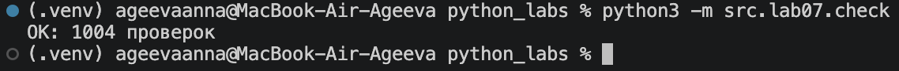
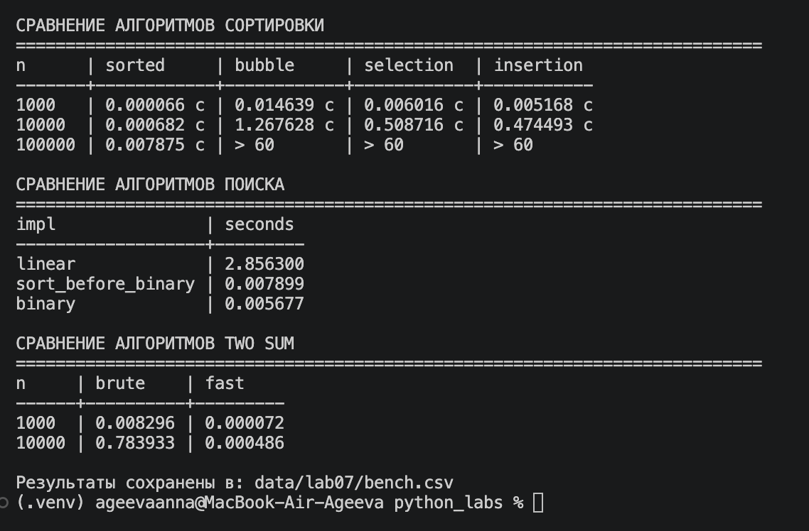
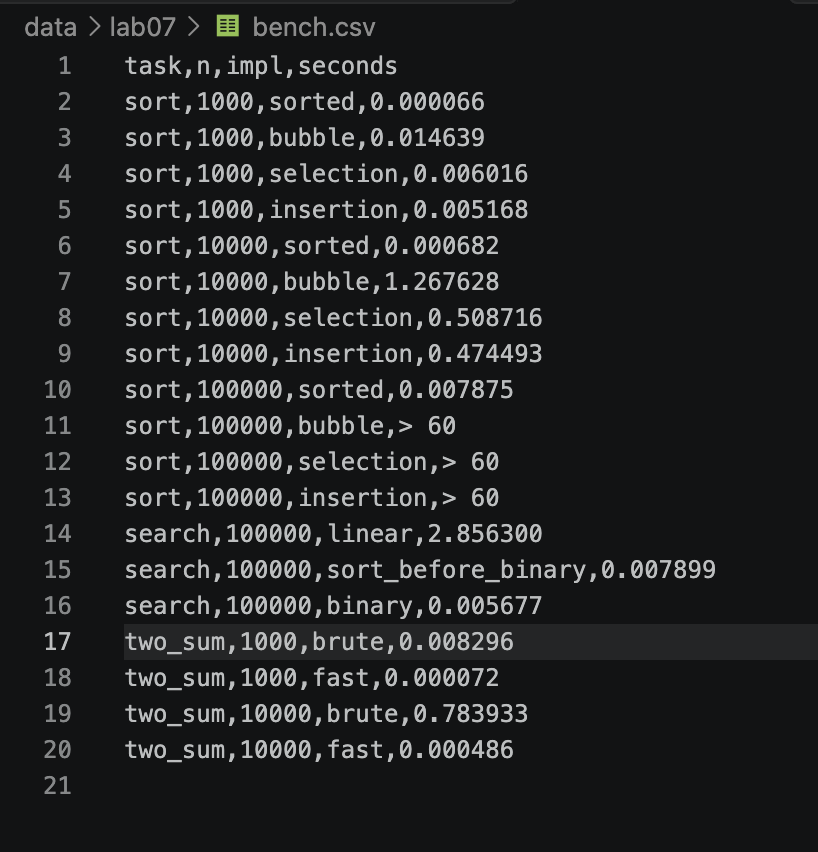

# Лабораторная работа № 7
## Поиск, сортировка и оценка сложности алгоритмов
## 1. Реализация алгоритмов поиска

В файле `search.py` реализованы следующие функции:

- `linear_search(nums, x)` — линейный поиск элемента.
  Алгоритм последовательно проверяет элементы списка.
  Сложность: O(n).

- `binary_search(sorted_nums, x)` — бинарный поиск.
  На каждом шаге область поиска уменьшается в два раза.
  Сложность: O(log n).
  Входной список должен быть отсортирован.

- `two_sum_brute(nums, target)` — поиск двух элементов
  с заданной суммой методом полного перебора.
  Сложность: O(n²).

- `two_sum_fast(nums, target)` — поиск двух элементов
  с помощью словаря.
  В среднем сложность: O(n).

### запуск программы

python3 -m src.lab07.search 

## 2. Реализация алгоритмов сортировки
В файле `sorting.py` реализованы три алгоритма:
- `bubble_sort(nums)` — сортировка пузырьком.
- `insertion_sort(nums)` — сортировка вставками.
- `selection_sort(nums)` — сортировка выбором.
Все функции возвращают новый отсортированный список
и не изменяют исходный список.

Для сравнения используется встроенная функция sorted().
### запуск программы 
python3 -m src.lab07.sorting 

## 3. Автоматическая проверка алгоритмов
Для проверки создан файл check.py.

Он проверяет:
- правильность работы алгоритмов сортировки;
- сохранение исходного списка;
- правильность линейного поиска;
- правильность бинарного поиска;
- совпадение результатов двух алгоритмов Two Sum.

Для проверки сортировок результат сравнивается
с результатом встроенной функции sorted().
Для поиска результат сравнивается с поведением list.index().

### запуск программы 
python3 -m src.lab07.check

Результат запуска:

Количество выполненных проверок: 1004.

## 4. Измерение времени работы алгоритмов
Для измерения времени создан файл bench.py.
Используется модуль timeit.

Измеряются:
1. Время работы алгоритмов сортировки.
2. Время работы линейного и бинарного поиска.
3. Время сортировки списка перед бинарным поиском.
4. Время работы двух алгоритмов Two Sum.

Результаты сохраняются в файл:
data/lab07/bench.csv

Запуск измерений
python3 -m src.lab07.bench

Результаты измерений

## 5. Выводы
## 5.1 Сравнение алгоритмов сортировки
При увеличении размера массива с 1 000 до 10 000 элементов время работы алгоритма `bubble_sort` увеличилось примерно в 87 раз: с 0,014639 до 1,267628 секунды. Алгоритмы `selection_sort` и `insertion_sort` также значительно замедлились — примерно в 85 и 92 раза соответственно. Это подтверждает, что квадратичные алгоритмы сортировки плохо подходят для обработки больших массивов. При размере массива 100 000 элементов время их работы превысило установленный предел в 60 секунд.
Встроенная функция `sorted` показала значительно лучшие результаты. При увеличении массива в 10 раз время её работы увеличилось примерно в 10–12 раз. Например, для 100 000 элементов сортировка заняла всего 0,007875 секунды. Это объясняется более эффективной сложностью алгоритма — O(n log n), в отличие от O(n²) у рассмотренных простых сортировок.

## 5.2. Сравнение алгоритмов поиска

Линейный поиск 10 000 элементов массива занял 2,856300 секунды. Бинарный поиск на предварительно отсортированном массиве занял всего 0,005677 секунды. Однако перед бинарным поиском необходимо отсортировать массив, что заняло ещё 0,007899 секунды.

Таким образом, общее время сортировки и последующего бинарного поиска составило примерно 0,013576 секунды, что значительно меньше времени линейного поиска. Это показывает, что сортировка окупается при большом количестве повторных поисковых запросов. Если же требуется выполнить только один или несколько поисков, предварительная сортировка может быть невыгодна. Важно помнить, что бинарный поиск можно применять только к уже отсортированному массиву.

## 5.3. Сравнение алгоритмов Two Sum
Для массива из 1 000 элементов алгоритм `two_sum_brute` выполнился за 0,008296 секунды, а `two_sum_fast` — за 0,000072 секунды. Быстрый алгоритм оказался примерно в 115 раз быстрее.
Для массива из 10 000 элементов разница стала ещё заметнее: полный перебор занял 0,783933 секунды, а алгоритм с использованием словаря — 0,000486 секунды. Таким образом, `two_sum_fast` оказался примерно в 1 613 раз быстрее. Это связано с тем, что полный перебор проверяет множество пар элементов, а быстрый алгоритм использует словарь для поиска нужного дополнения за один проход по массиву.

## 5.4. Общий вывод
Эксперименты показали, что выбор алгоритма существенно влияет на скорость выполнения программы. Для больших массивов предпочтительнее использовать эффективные алгоритмы сортировки и поиска, а также структуры данных, например словари. Простые алгоритмы с квадратичной сложностью могут быть удобны для изучения, но при увеличении объёма данных становятся слишком медленными.